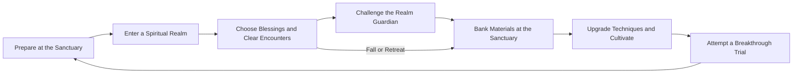

# Game Design Document

## 1. World and narrative

Qinglan Sanctuary stands above a valley where the spiritual veins have fractured. The player is an apprentice maintaining the sanctuary after its senior cultivators depart. Two corrupted spiritual anchors threaten the valley. Restore them, establish a stable foundation, and form a Golden Core to withstand the final storm.

The player is not a chosen sovereign of an enormous universe. A focused local problem makes a complete story feasible. All factions, characters, place names, symbols, and dialogue are original. Cultivation, Five Elements, talismans, mountain gates, and tribulations provide cultural inspiration without reproducing a particular novel or commercial game's story.

### Main cast

| Character | Role | Delivery |
| --- | --- | --- |
| The Apprentice | Player; unnamed, customizable profile label | Environmental reaction and minimal text |
| Elder Yun | Mentor present through letters and shrine inscriptions | Tutorial and breakthrough guidance |
| Keeper Lan | Sanctuary caretaker | Three short quest exchanges |
| The Broken Guardian | Final opponent tied to the valley's anchors | Visual storytelling; no voiced dialogue |

Story progression is a fixed sequence: awaken → train → restore Bamboo Hollow → pass the Foundation trial → restore Ashen Peak → pass the Golden Core trial → ending scene and free replay. Target 15–20 minutes of total reading across the campaign, with skippable dialogue and a journal summary.

## 2. Player experience pillars

1. **Cultivation changes capability.** Each realm unlocks a useful play option, with deterministic breakthrough conditions.
2. **Spells feel physical.** Energy gathers before release; attacks interact visually with air, ground, light, and sound.
3. **Preparation matters.** A limited loadout creates choices between burst, control, sustain, and protection.
4. **Fair failure.** Telegraphs are readable; expedition failure preserves permanent progress.

## 3. Core loops

Second-to-second loop: position → recognize a telegraph → commit to a sword or technique → dodge or interrupt → recover energy → reposition. Room loop: enter → fight or interact → collect → choose one of three blessings when offered → checkpoint → move on.

An expedition owns temporary blessings, room states, earned-but-unbanked loot, and its random seed. A profile owns cultivation, unlocked techniques, upgraded relics, journal entries, banked currency, and campaign flags. This separation governs saving and failure handling.

## 4. First ten minutes

| Time | Player action | Intended learning |
| --- | --- | --- |
| 0:00–1:00 | Choose a profile; move through a calm courtyard | Camera and movement |
| 1:00–3:00 | Strike training targets; dodge a slow construct | Basic combo, stamina, telegraphs |
| 3:00–5:00 | Cast Jade Sword Arc and use a shrine | Spiritual energy and recovery |
| 5:00–7:00 | Enter the first guided realm room | Lock-on and elemental setup |
| 7:00–9:00 | Clear a mixed encounter and select a blessing | Build choice |
| 9:00–10:00 | Return through a shrine and cultivate | Banking and permanent growth |

Tutorial prompts never block an ongoing enemy attack. The first excursion uses a short fixed route and a safe return shrine; the full expedition unlocks afterward. Tutorial skip becomes available on later profiles and preserves mandatory initial unlocks.

## 5. Realm design

No runtime generation of cliffs, temples, or collision meshes. Use hand-authored connected rooms with seeded encounter and reward variation. This keeps lighting, navigation, traversal, composition, and performance testable.

### Bamboo Hollow

Wet stone paths, bamboo, broken mountain gates, morning mist, shallow water, and jade-colored spiritual veins. Introduces melee, ranged pressure, Wet status, and lightning interaction. Modular room footprints: 35–55 meters across, at least two unobstructed dodge lanes, no damaging bottomless pits.

### Ashen Peak

Charred pines, dark volcanic stone, scorched shrines, warm embers, and wind-driven ash. Introduces Burn, protective Earth barriers, and more aggressive encounter timing. Reuses rock and shrine structures with new materials and layouts; it is not a full second environment pipeline.

### Seven-room layout

| Index | Type | Rules |
| --- | --- | --- |
| 0 | Entrance | No enemies; loadout confirmation; suspend allowed |
| 1 | Combat | One basic archetype; 4–6 enemies total |
| 2 | Combat | Two archetypes; first blessing choice |
| 3 | Shrine or event | Free heal; optional lore or exchange |
| 4 | Elite | Mixed wave; guaranteed material; second blessing |
| 5 | Boss | Arena closes; defeat grants campaign flag |
| 6 | Exit shrine | Banking preview; return confirmation |

An authored optional alcove may be attached to room 2 or 3 but does not change the count. Navigation validates entrance-to-exit paths before release. Doors are explicit interactables; after all living encounter enemies are defeated, unlock the door once. Ambient decorative creatures do not count.

## 6. Encounter selection

Use weighted, versioned encounter lists. Each room defines archetype eligibility, maximum concurrent enemies, spawn markers, reward table, and expected duration. A seeded `FRandomStream` selects the encounter and blessing offers. Use separate streams for encounters, loot, and blessings so adding a cosmetic effect does not change rewards.

At most eight active ordinary enemies, or one boss with at most two adds. Introduce no more than one new behavior per tutorial encounter. Enemy spawns occur behind an obvious portal with a 0.8-second warning and may not appear within 4 meters of the player. The same seed reproduces content selections; identical physics or frame timing across platforms is not promised.

## 7. Outcomes and replay

Victory banks all earned loot. Voluntary retreat banks 70% of unbanked Spirit Shards and common materials, rounded down per stack. Defeat banks 50%. Guaranteed quest proof from a defeated boss is never lost. Permanent upgrades and already banked inventory cannot be lost.

Boss clear flags commit immediately at a safe reward screen so a later failure or crash cannot erase a completed story objective. First-clear rewards are keyed by boss and profile and can be awarded only once. Repeat runs award ordinary materials and a different blessing combination.

After the ending, unlock Ascended Challenge: optional stronger encounters with no exclusive ending or paid unlock. It is a stretch feature and may be omitted from 1.0. Normal replay remains available.

## 8. Accessibility and interaction

Pause freezes combat and timers. Focus loss pauses single-player play. Dialogue pauses world interaction in safe areas. Provide camera shake strength, motion blur toggle, flashes reduction, independent music/effects volumes, subtitles for meaningful nonverbal cues, text scale, invert camera axes, aim sensitivity, and hold/toggle lock-on.

Use shape plus color to distinguish threats. Decorative glyphs cannot replace localized instructions. All actionable text is available in English and Simplified Chinese. A brief low-flash mode preserves attack outlines while removing bright full-screen lightning and post-process pulses.
